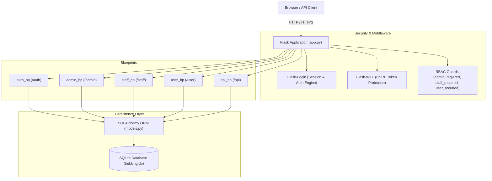
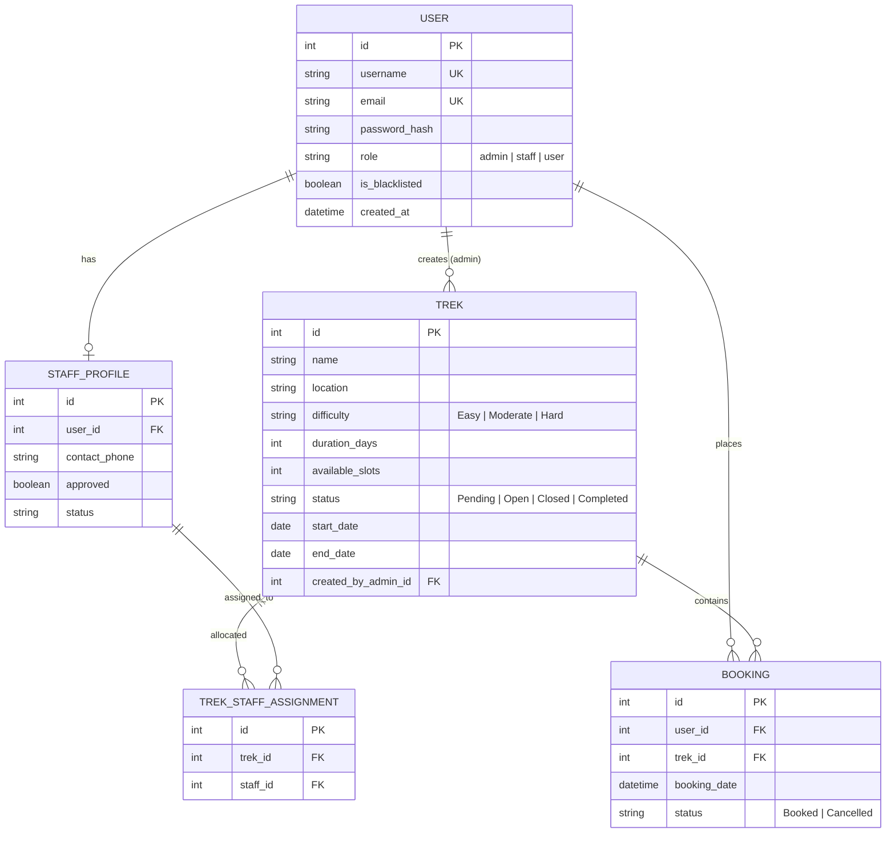

# 🏔️ TrekSync — Trekking Expedition & Logistics Management Platform

[](https://www.python.org/)
[](https://flask.palletsprojects.com/)
[](https://flask-sqlalchemy.palletsprojects.com/)
[](https://getbootstrap.com/)
[](#)

---

## 📋 Submission Information

| Field | Details |
| :--- | :--- |
| **Project Name** | **TrekSync** (Trekking Management Application) |
| **Student Name** | Naman |
| **Email** | [namangolchha200506@gmail.com](mailto:namangolchha200506@gmail.com) |
| **GitHub Repository** | [https://github.com/25f3002792/TrekSync.git](https://github.com/25f3002792/TrekSync.git) |
| **Deployed Application / Build** | *[Insert Deployed URL / Local Execution Build]* |
| **Demo Video Link** | *[Insert 3–5 Minute Walkthrough Video Link (e.g., YouTube / Google Drive)]* |
| **Technology Stack** | Python, Flask, Flask-SQLAlchemy, SQLite, Flask-Login, Flask-WTF, Bootstrap 5, OpenAPI 3.0 |

---

## 📌 Problem Statement

Organizing high-altitude trekking expeditions, managing slot inventory, assigning certified field guides, and coordinating trekker registrations is traditionally fragmented across disparate spreadsheets, messaging apps, and ad-hoc booking forms. 

This manual approach introduces severe operational bottlenecks:
- **Overbooking & Race Conditions**: Inaccurate tracking of real-time seat capacities causes double-bookings or logistical failures at remote base camps.
- **Guide & Staff Accountability Gaps**: Unverified personnel, lack of clear trek-to-guide assignments, and absence of live participant rosters compromise trekker safety.
- **Fragmented User Experience**: Adventure seekers lack a centralized portal to search treks by terrain difficulty, filter departure dates, track reservations, or process cancellations with automated slot recovery.
- **Administrative Blindspots**: Expedition managers lack a unified operations dashboard to moderate users, approve qualified staff, oversee capacity metrics, and inspect global booking manifests.

---

## 🎯 Target Users

TrekSync is designed for three distinct user personas with customized role-based interfaces:

1. **Adventurers & Trekkers (`user`)**
   - Outdoor enthusiasts seeking expedition schedules, elevation/difficulty filters, and transparent real-time slot availability.
   - Capable of booking trips, monitoring reservation status, cancelling bookings with automated slot replenishment, and maintaining user profiles.
2. **Field Guides & Trek Staff (`staff`)**
   - Certified mountaineers and on-ground expedition leaders requiring verified access.
   - Need real-time participant rosters, dynamic slot capacity updates, and expedition status progression controls (`Open` → `Closed` → `Completed`).
3. **Expedition Administrators (`admin`)**
   - Platform managers governing expedition itineraries, staff approvals, user moderation (blacklisting/unblacklisting), guide assignments, global bookings, and platform analytics.

---

## 💡 Solution Overview

**TrekSync** is a full-stack, multi-role web platform and RESTful service engine built to streamline the lifecycle of wilderness expeditions. It establishes an atomic state machine for expedition management:

```
[Admin Creates Trek] ──► [Admin Approves & Assigns Staff] ──► [Trek Set to 'Open']
                                                                   │
                                                                   ▼
[Trek Completed] ◄── [Staff Updates Status] ◄── [User Books Slot (Atomic -1)]
```

- **Role-Based Access Control (RBAC)**: Distinct permissions for Trekkers, Field Staff, and Administrators.
- **Atomic Slot Management**: State-locked booking engine that decrements available slots upon reservation and replenishes them upon cancellation, guarded against duplicate reservations via database-level uniqueness constraints.
- **Two-Phase Staff Onboarding**: Self-registration followed by mandatory administrative vetting before field assignments are unlocked.
- **Hybrid Architecture**: Server-rendered Jinja2 interface with responsive Bootstrap 5 styling, alongside decoupled OpenAPI-compliant REST endpoints (`/api/treks`, `/api/bookings`).

---

## ✨ Key Features & User Capabilities

### 🥾 For Trekkers (End Users)
- **Expedition Discovery & Multi-Parametric Search**:
  - Filter open treks by difficulty level (`Easy`, `Moderate`, `Hard`), destination name, or geographical location with instant query filtering.
- **Instant Atomic Reservations**:
  - Real-time slot availability check (`available_slots > 0`).
  - Automatic deduction of slot inventory upon successful reservation.
  - Hard constraint preventing duplicate bookings for the same user on the same trek.
- **Self-Service Reservation Dashboard**:
  - Live history of active and completed bookings with chronological sorting.
  - One-click cancellation with immediate database slot restoration.
- **Profile Management**: Update contact details and email preferences.

### 🧗 For Trek Staff & Field Guides
- **Staff Registration & Vetting Gate**: Dedicated registration flow requiring administrative verification prior to dashboard access.
- **Assigned Expeditions Hub**: Access all treks explicitly assigned by administrators.
- **Live Participant Manifest**: View verified lists of participants booked on assigned treks.
- **Field Capacity & Status Overrides**: Dynamically adjust remaining slots and update trek phase (`Open`, `Closed`, `Completed`) during field operations.

### 🛡️ For Administrators
- **Executive Operations Dashboard**:
  - Metric overview displaying Total Treks, Active Trekkers, Registered Staff, and Total Bookings.
- **Complete Expedition Lifecycle Management (CRUD)**:
  - Create, view, edit, and delete treks.
  - Date sanity validation (start dates cannot be backdated; end dates must follow start dates).
  - Dynamic duration calculation computed directly from itinerary dates.
- **Staff Vetting & Assignment Engine**:
  - One-click staff approval or revocation.
  - Guide allocation matrix linking verified staff to active expeditions with constraint safety (`unique_trek_staff`).
- **User Governance & Moderation**:
  - Global user directory with instant toggle to **blacklist** or **unblacklist** malicious or inactive accounts.
  - Blacklisted accounts are denied login authorization system-wide.
- **Global Search & Query Terminal**:
  - Unified search engine querying users and treks simultaneously across alphanumeric keys and usernames.

### 🔌 RESTful API Integration
- Exposes standardized JSON endpoints for external client integrations.
- Formally documented with OpenAPI 3.0 specification (`api.yaml`).

---

## 🏗️ Architecture & Technical Decisions

### Architecture Diagram



### Database Schema (ER Model)



---

## ⚙️ Engineering Depth & Application Logic

### 1. Atomic Booking & Concurrency Integrity
In wilderness operations, allowing more reservations than equipment or guide ratios permit can be hazardous. TrekSync handles this through strict state validation:
```python
# Atomic check and inventory decrement in user.py
if trek.status != 'Open' or trek.available_slots <= 0:
    flash('No slots available.', 'danger')
    return redirect(url_for('user.treks'))

existing = Booking.query.filter_by(user_id=current_user.id, trek_id=trek.id).first()
if existing:
    flash('You have already booked this trek.', 'warning')
    return redirect(url_for('user.bookings'))

booking = Booking(user_id=current_user.id, trek_id=trek.id, status='Booked')
trek.available_slots -= 1
db.session.add(booking)
db.session.commit()
```
Coupled with a database-level `UniqueConstraint('user_id', 'trek_id', name='unique_user_trek_booking')`, the application prevents race conditions and duplicate double-bookings.

### 2. State-Driven Cancellation & Automatic Slot Replenishment
When a trekker cancels a booking:
1. Authorization check confirms the booking belongs to `current_user`.
2. Validates that current booking status is `Booked`.
3. Sets status to `Cancelled` and immediately increments `available_slots += 1` within an atomic transaction.

### 3. Role-Based Access Control (RBAC) & Route Protection
Access control is implemented via modular gatekeeper functions:
- `admin_required()`: Verifies authenticated user role is strictly `admin`; aborts with `HTTP 403 Forbidden` otherwise.
- `staff_required()`: Verifies authenticated user role is `staff` **AND** profile is marked `approved == True`.
- `user_required()`: Restricts standard participant routes to `user` role.
- Dynamic route redirection (`dashboard_redirect`) routes authenticated users to their corresponding view automatically upon login.

### 4. Input & Date Sanity Validation
Form submissions are validated with custom WTForms logic:
- Prevents scheduling treks in the past: `start_date >= date.today()`.
- Guarantees chronological consistency: `end_date > start_date`.
- Enforces strict email structure and minimum password length constraints.

---

## 🔒 Security Practices

- **Password Security**: Passwords are never stored in plaintext. They are hashed using `werkzeug.security.generate_password_hash` with modern key-derivation algorithms and verified with `check_password_hash`.
- **Session Security**: Session cookies managed via Flask-Login with configurable cryptographic secrets (`SECRET_KEY`).
- **CSRF Protection**: All forms utilize Flask-WTF automated CSRF token generation and validation.
- **Account Blacklisting**: Moderation layer checks `user.is_blacklisted` during login. Blacklisted entities are denied authentication with clear security flash notifications.
- **Parameter Tampering Defense**: Cancellation and administrative mutation routes enforce ownership and permission validation before any state transition.
- **Safe Configuration**: Secrets are loaded from environment variables (`Config` class in `config.py`), preventing committed credentials in version control.

---

## 💻 Tech Stack

| Domain | Technology | Purpose |
| :--- | :--- | :--- |
| **Backend Framework** | Python 3 / Flask 2.3.3 | Core application routing, request handling, and business logic |
| **ORM & Database** | Flask-SQLAlchemy 3.1.1 / SQLite 3 | Relational object modeling, relational integrity, and persistence |
| **Authentication** | Flask-Login 0.6.2 / Werkzeug 2.3.7 | User session lifecycle, password hashing, and login state |
| **Form & Validation** | Flask-WTF 1.1.1 / WTForms 3.0.1 | Form rendering, CSRF protection, and server-side data validation |
| **Email Validation** | email_validator 2.1.1 | RFC-compliant email verification |
| **API Architecture** | Flask / Flask-RESTful / OpenAPI 3.0 | REST endpoints (`/api/treks`, `/api/bookings`) & `api.yaml` specification |
| **Frontend Styling** | Bootstrap 5.3, FontAwesome 6, Custom CSS | Modern responsive UI, glassmorphic accents, cards, and data tables |
| **Templating Engine** | Jinja2 | Dynamic HTML templating with layout inheritance (`base.html`) |

---

## 📡 API Documentation

TrekSync provides RESTful endpoints documented via the OpenAPI 3.0 standard in [`api.yaml`](file:///c:/Users/Asus/OneDrive/Desktop/Trekking%20Management%20App%28MAD%201%29/api.yaml).

### Endpoints Overview

| Method | Endpoint | Description | Auth Required | Response Format |
| :--- | :--- | :--- | :---: | :--- |
| `GET` | `/api/treks` | Retrieve all scheduled treks with location, slots, and status | No | JSON Array of `Trek` objects |
| `GET` | `/api/bookings` | Retrieve bookings (Role-aware: Admin sees all; User sees own) | Yes (Session) | JSON Array of `Booking` objects |

#### Sample `/api/treks` Response:
```json
[
  {
    "id": 1,
    "name": "Everest Base Camp",
    "location": "Nepal",
    "difficulty": "Hard",
    "available_slots": 10,
    "status": "Open"
  },
  {
    "id": 2,
    "name": "Annapurna Circuit",
    "location": "Nepal",
    "difficulty": "Moderate",
    "available_slots": 15,
    "status": "Open"
  }
]
```

---

## 📁 Repository Directory Structure

```text
TrekSync/
│
├── app.py                  # Main Flask application entry point & factory setup
├── config.py               # Application configuration & environment parameters
├── models.py               # SQLAlchemy ORM models (User, StaffProfile, Trek, Booking, etc.)
├── forms.py                # WTForms definitions & custom field validators
├── requirements.txt        # Pinned Python package dependencies
├── api.py                  # RESTful API route blueprint (/api)
├── api.yaml                # Formal OpenAPI 3.0 API specification document
│
├── auth.py                 # Blueprint: User registration, login, logout, and redirection
├── admin.py                # Blueprint: Administrator dashboard, trek CRUD, staff vetting, user moderation
├── staff.py                # Blueprint: Field guide dashboard, trek participant rosters, status updates
├── user.py                 # Blueprint: Trekker discovery, reservation booking, profile, and cancellations
│
├── templates/              # Jinja2 HTML templates
│   ├── base.html           # Unified master layout with modern styling & navigation bar
│   ├── auth/               # Authentication templates (login.html, register.html)
│   ├── admin/              # Admin templates (dashboard, treks, staff, users, assign_staff, bookings, search)
│   ├── staff/              # Staff templates (dashboard, manage_trek, participants)
│   └── user/               # Trekker templates (dashboard, treks, bookings, profile)
│
└── instance/               # Local SQLite database storage (excluded from VCS)
```

---

## 🚀 Local Setup & Installation

Follow these steps to run TrekSync locally on your machine:

### 1. Prerequisites
- Python 3.10 or higher installed on your system.
- Git installed.

### 2. Clone the Repository
```bash
git clone https://github.com/25f3002792/TrekSync.git
cd TrekSync
```

### 3. Create and Activate a Virtual Environment

- **On Windows (PowerShell):**
  ```powershell
  python -m venv venv
  .\venv\Scripts\Activate.ps1
  ```

- **On Windows (Command Prompt):**
  ```cmd
  python -m venv venv
  .\venv\Scripts\activate.bat
  ```

- **On macOS / Linux:**
  ```bash
  python3 -m venv venv
  source venv/bin/activate
  ```

### 4. Install Dependencies
```bash
pip install -r requirements.txt
```

### 5. Configure Environment Variables (Optional)
The application works out of the box with default development credentials. To configure custom production secrets, set:
```bash
# Windows PowerShell
$env:SECRET_KEY="your-super-secret-random-key"

# Linux / macOS
export SECRET_KEY="your-super-secret-random-key"
```

### 6. Initialize Database & Run Application
```bash
python app.py
```

The database tables will automatically be provisioned upon first boot, and a default administrative account will be seeded.

Access the platform at:
👉 **`http://127.0.0.1:5000`**

---

## 🔑 Default Credentials for Evaluation

For rapid grading and evaluator walkthrough, pre-configured roles are accessible:

| Role | Username | Password | Notes |
| :--- | :--- | :--- | :--- |
| **Administrator** | `admin` | `admin123` | Pre-seeded on first database run. Full platform control. |
| **Field Staff** | *Self-Register* | *User-defined* | Register selecting "Trek Staff". Login to Admin to approve the account. |
| **Trekker** | *Self-Register* | *User-defined* | Register selecting "Trekker". Immediate booking access. |

---

## 🧪 Testing & Verification Guide

| Test Scenario | Action | Expected Result |
| :--- | :--- | :--- |
| **1. User Registration** | Register as a Trekker with valid email | Redirects to login with success flash message. |
| **2. Staff Approval Gate** | Register as Trek Staff and attempt login | System denies dashboard entry with "Pending admin approval" warning. |
| **3. Admin Approval** | Log in as `admin`, navigate to `/admin/staff`, click "Approve" | Staff status updates to approved; staff can now access `/staff/dashboard`. |
| **4. Date Validation** | Create a trek with an end date earlier than start date | WTForms validation flags error: *"End date must be after start date."* |
| **5. Booking Deduction** | Book a trek with 5 available slots as a Trekker | Booking confirmed; trek slot count immediately decrements to 4. |
| **6. Duplicate Booking** | Attempt to book the same trek again | Intercepted with warning: *"You have already booked this trek."* |
| **7. Cancellation Recovery** | Cancel the booked reservation from `/user/bookings` | Status transitions to `Cancelled`; available slots increment back to 5. |
| **8. Moderation / Blacklist**| Admin blacklists a user via `/admin/users` | Blacklisted user's subsequent login attempts are rejected with warning. |

---

## 🌐 Deployment Instructions

TrekSync is production-ready for deployment on WSGI platforms such as **Render**, **Railway**, **PythonAnywhere**, or **Heroku**:

1. **Add `gunicorn` to dependencies**:
   ```bash
   pip install gunicorn
   pip freeze > requirements.txt
   ```
2. **Add a `Procfile`**:
   ```text
   web: gunicorn app:app
   ```
3. **Set Environment Variables on Host**:
   - `SECRET_KEY`: Set to a strong cryptographic token.
   - `FLASK_ENV`: Set to `production`.
4. Deploy the repository and verify all routes and database persistence operate correctly.

---

## 👥 Author & Acknowledgements

- **Developer**: Naman ([@25f3002792](https://github.com/25f3002792))
- **Course**: Modern Application Development 1 (MAD 1) / End-Term Software Project
- **Academic Year**: 2026
